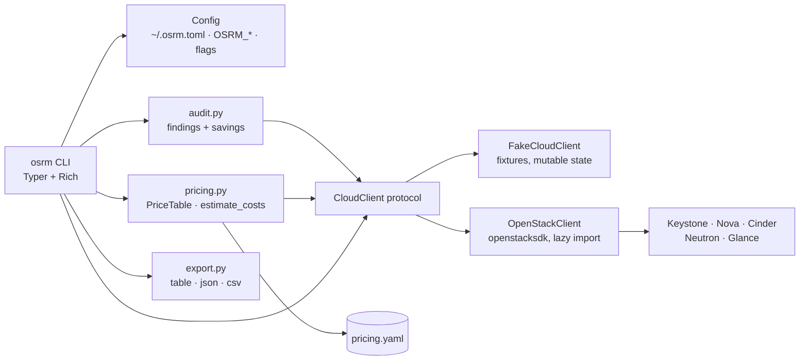

<!-- topics: openstack,python,cli,typer,cloud,devops,cost-optimization,infrastructure -->
# OpenStack Resource Manager (osrm)

Typer CLI and Python library to inventory OpenStack resources, find idle and orphaned ones, and estimate what each project costs per month.

[](https://github.com/AkibUllah/openstack-resource-manager/actions/workflows/ci.yml)


## Try it live

| | |
|---|---|
| Run in your browser | [](https://codespaces.new/AkibUllah/openstack-resource-manager?quickstart=1) — installs `osrm` against the bundled fake cloud (`OSRM_BACKEND=fake`) and runs `osrm audit` when the terminal opens; then try `osrm servers list`, `osrm cost estimate --project pathao-prod`, `osrm export --format json` |
| Local | `make install demo` or `docker build -t osrm . && docker run --rm osrm audit` (see Quick Start) |

No hosted page: `osrm` is a CLI that talks to an OpenStack cloud (or the fixture backend), so the Codespace is the demo.

## Why this exists

Operating an OpenStack cloud for internal teams, the same questions came up every month: which servers have been SHUTOFF since a project ended, which 500 GB volumes are attached to nothing, who is holding floating IPs they never routed, and what does each project actually cost at our flavor prices. The `openstack` CLI answers none of these directly. `osrm` wraps the SDK behind a small `CloudClient` protocol so the audit and cost logic is plain Python, ships a fixture-backed `FakeCloudClient` so everything can be demoed and tested without a cloud, and renders results as Rich tables, JSON or CSV for the finance spreadsheet.

## Features

- `CloudClient` protocol with two implementations: `OpenStackClient` (openstacksdk, imported lazily, optional extra) and `FakeCloudClient` (three realistic projects: ride-hailing prod, grocery staging, payment sandbox)
- `osrm servers list|show|stop|start|delete` with `--dry-run` and confirmation on delete; lookup by id or name
- `osrm volumes list --orphaned`, `osrm ips list --unused`, `osrm projects`
- `osrm audit`: idle servers (SHUTOFF for N days, or ACTIVE under a CPU threshold), oversized servers, orphaned volumes, unused floating IPs, resources stuck in ERROR, each with severity, a recommendation and the monthly saving in your currency
- `osrm cost estimate [--project X]`: hourly / monthly totals by project and resource type from a YAML flavor price table, with a per-vCPU/RAM fallback for unknown flavors and a note listing them
- `osrm export --format json|csv|table [--output file]` for servers, volumes, IPs, flavors, images, projects or everything
- Configuration layering: defaults < `~/.osrm.toml` < `OSRM_*` / `OS_CLOUD` environment < CLI flags; clouds.yaml is reused unchanged
- Decimal money, timezone-aware timestamps, typed exceptions mapped to exit codes

## Architecture



Key decisions:

- **Protocol first.** Every command talks to `CloudClient`; `audit.py` and `pricing.py` never import the SDK. That is what makes 37 tests run in under two seconds with no cloud, and what lets the same CLI binary run against fixtures (`OSRM_BACKEND=fake`) for demos and dry-runs.
- **openstacksdk stays optional.** It is imported inside `OpenStackClient.__init__`, so `pip install openstack-resource-manager` is light and a missing SDK produces one clear error rather than an import traceback.
- **Audit heuristics are explicit and tunable.** Thresholds (`idle_days`, `idle_cpu_percent`, `oversized_cpu_percent`, `oversized_min_vcpus`, `orphan_volume_days`, `unused_ip_days`) live in config, and every finding states which rule fired and what it would save.
- **Savings are priced with the same table as estimates.** A stopped server's saving is its attached storage (compute is free while SHUTOFF under the default table); an oversized server's saving assumes a flavor half the size.
- **Mutating commands are boring on purpose.** `--dry-run` resolves the target and prints what would happen; `delete` prompts unless `--yes`; the fake backend detaches volumes and releases IPs exactly like Nova/Neutron so tests can assert side effects.

## Tech Stack

| Layer | Choice |
| --- | --- |
| CLI | Typer, Rich tables |
| Cloud access | openstacksdk (optional extra `[openstack]`), clouds.yaml / `OS_*` auth |
| Config | TOML (`tomllib` / `tomli`), environment variables |
| Pricing | YAML price table, `decimal.Decimal` |
| Tooling | pytest + `typer.testing.CliRunner`, ruff, GitHub Actions |
| Packaging | PEP 621 `pyproject.toml`, console script `osrm`, bundled `data/pricing.yaml` |

## Quick Start

### Local, against the bundled fake cloud

```bash
git clone git@github.com:AkibUllah/openstack-resource-manager.git
cd openstack-resource-manager
python3 -m venv .venv && source .venv/bin/activate
pip install -e ".[dev]"

export OSRM_BACKEND=fake
osrm servers list
osrm audit
osrm cost estimate --project pathao-prod
```

### Against a real cloud

```bash
pip install -e ".[openstack]"
cp examples/osrm.toml ~/.osrm.toml      # backend = "openstack", cloud = "<clouds.yaml entry>"
export OS_CLOUD=dhaka-prod              # or set `cloud` in ~/.osrm.toml
osrm projects
osrm audit --min-severity medium
```

### Docker

```bash
docker build -t osrm .
docker run --rm osrm audit                                   # fake backend baked in as default
docker run --rm -e OSRM_BACKEND=openstack -e OS_CLOUD=dhaka-prod \
  -v ~/.config/openstack:/home/app/.config/openstack:ro osrm servers list
```

## Usage

### Commands

| Command | What it does |
| --- | --- |
| `osrm servers list [-p PROJECT] [--status SHUTOFF] [-f table\|json\|csv]` | Servers with flavor, project, IP and age |
| `osrm servers show SERVER [-f json]` | One server with flavor, volumes, floating IPs and metrics |
| `osrm servers stop\|start SERVER [--dry-run]` | Power actions (id or name) |
| `osrm servers delete SERVER [--dry-run] [--yes]` | Delete with confirmation |
| `osrm volumes list [--orphaned]` | Volumes; `--orphaned` = available and unattached |
| `osrm ips list [--unused]` | Floating IPs; `--unused` = no port |
| `osrm projects` | Projects visible to the credentials |
| `osrm audit [-p PROJECT] [--kind K]... [--min-severity low\|medium\|high] [-f json]` | Findings with monthly savings |
| `osrm cost estimate [-p PROJECT] [--pricing file.yaml] [--detail] [-f json\|csv]` | Hourly / monthly costs |
| `osrm export [-r servers\|volumes\|ips\|flavors\|images\|projects\|all] [-f json\|csv\|table] [-o FILE]` | Inventory export |

Global flags: `--backend fake|openstack`, `--cloud NAME`, `--config PATH`, `--version`.

### Sample output (fake backend)

```
$ osrm audit
                                  Audit findings (13)
┏━━━━━━━━━━┳━━━━━━━━━━━━━━━━━━━━┳━━━━━━━━━━━━━━━━━━━┳━━━━━━━━━━━━━━━━━━━┳━━━━━━━━━━━━━━━━━━━━━━━━┳━━━━━━━━━━━━━━━━┳━━━━━━━━━━━━━━━━━━━━━━━━┓
┃ severity ┃ kind               ┃ name              ┃ project_id        ┃ message                ┃ monthly_saving ┃ recommendation         ┃
┡━━━━━━━━━━╇━━━━━━━━━━━━━━━━━━━━╇━━━━━━━━━━━━━━━━━━━╇━━━━━━━━━━━━━━━━━━━╇━━━━━━━━━━━━━━━━━━━━━━━━╇━━━━━━━━━━━━━━━━╇━━━━━━━━━━━━━━━━━━━━━━━━┩
│ high     │ idle_server        │ legacy-sim        │ p-bkash-sandbox   │ SHUTOFF for 120 days   │           0.00 │ Snapshot and delete,…  │
│ high     │ orphaned_volume    │ db-backup-2025-12 │ p-pathao-prod     │ 500 GB available, …    │          73.00 │ Snapshot to object s…  │
│ ...      │                    │                   │                   │                        │                │                        │
└──────────┴────────────────────┴───────────────────┴───────────────────┴────────────────────────┴────────────────┴────────────────────────┘
scanned 12 servers, 11 volumes, 8 floating_ips · potential saving 36266.40 BDT/month
```

```
$ osrm cost estimate --project pathao-prod
       Monthly cost by project
┏━━━━━━━━━━━━━┳━━━━━━━━━━┳━━━━━━━━━━┓
┃ project     ┃  monthly ┃ currency ┃
┡━━━━━━━━━━━━━╇━━━━━━━━━━╇━━━━━━━━━━┩
│ pathao-prod │ 45800.20 │ BDT      │
└─────────────┴──────────┴──────────┘
     Monthly cost by resource type
┏━━━━━━━━━━━━━━━┳━━━━━━━━━━┳━━━━━━━━━━┓
┃ resource_type ┃  monthly ┃ currency ┃
┡━━━━━━━━━━━━━━━╇━━━━━━━━━━╇━━━━━━━━━━┩
│ floating_ip   │  1095.00 │ BDT      │
│ server        │ 44530.00 │ BDT      │
│ volume        │   175.20 │ BDT      │
└───────────────┴──────────┴──────────┘
total 45800.20 BDT/month (62.74 BDT/hour, 730 h/month, prices: bundled)
```

### Pricing table

`src/osrm/data/pricing.yaml` ships BDT rates for a Dhaka-hosted cloud; point `--pricing` or `OSRM_PRICING` at your own:

```yaml
currency: BDT
hours_per_month: 730
flavors:
  m1.small: 2.50        # per hour
  c2.highcpu: 36.00
fallback:               # unknown flavors
  per_vcpu_hour: 2.00
  per_ram_gb_hour: 0.60
volume_gb_hour: 0.0002
floating_ip_hour: 0.50
stopped_server_discount: 1.0   # 1.0 = SHUTOFF compute is free
```

### As a library

```python
from osrm.audit import run_audit
from osrm.clients.fake import FakeCloudClient
from osrm.config import AuditThresholds
from osrm.pricing import PriceTable, estimate_costs

client = FakeCloudClient()                     # or OpenStackClient(cloud="dhaka-prod")
table = PriceTable.load()                      # or PriceTable.load(Path("prices.yaml"))

report = run_audit(client, table, AuditThresholds(idle_days=30))
for finding in report.filter(min_severity="medium"):
    print(finding.kind, finding.name, finding.monthly_saving)

estimate = estimate_costs(client, table, project_id="p-pathao-prod")
print(estimate.by_project(), estimate.monthly_total)
```

## Project Structure

```
src/osrm/
├── cli.py              # Typer app: servers, volumes, ips, projects, audit, cost, export
├── config.py           # Config/AuditThresholds, ~/.osrm.toml + env merging, build_client()
├── models.py           # Server, Flavor, Volume, FloatingIP, Network, Image, Project, ServerMetrics
├── audit.py            # run_audit -> AuditReport of Findings with savings
├── pricing.py          # PriceTable (YAML), CostLine/CostEstimate, estimate_costs
├── export.py           # Rich table / JSON / CSV rendering
├── exceptions.py       # OsrmError, NotFound, InvalidState, BackendUnavailable
├── clients/
│   ├── base.py         # CloudClient protocol
│   ├── fake.py         # FakeCloudClient with fixtures (3 projects, 12 servers, 11 volumes, 8 IPs)
│   └── openstack.py    # OpenStackClient on openstacksdk (lazy import)
└── data/pricing.yaml   # bundled BDT price table
examples/               # osrm.toml and clouds.yaml templates
tests/                  # 37 tests (CliRunner + unit), fake backend only
```

## Testing

```bash
make test      # or: pytest
make lint
make demo      # audit + cost estimate against the fake cloud
```

Covered: fixture consistency and start/stop/delete side effects in the fake client; flavor pricing (exact, fallback, stopped discount), cost totals that add up to hand-computed figures, custom YAML tables; every audit finding kind, priced savings, severity ordering, threshold tuning, project scope and filters; JSON/CSV/table export; config precedence (defaults, TOML, env, `--config`); and the CLI end to end: listings in all formats, `show`, dry-run vs real stop/start, delete confirmation, orphaned/unused filters, audit and cost output in table/JSON, custom pricing, export to file, bad inputs, and the clean error when openstacksdk is missing.

The `OpenStackClient` is not exercised in CI (it needs a cloud); it maps SDK objects onto the same models the fake client returns, so everything above applies to both.

## Roadmap

- Telemetry source for `get_server_metrics` on real clouds (Gnocchi / Prometheus exporter) so idle and oversized detection works beyond fixtures
- `osrm audit --apply` to stop idle servers and release unused IPs in one reviewed batch
- Snapshot and image audits (orphaned snapshots, images with no servers)
- Scheduled report mode writing JSON/CSV to object storage and posting a summary to Slack
- Quota view per project alongside usage

## License

MIT © 2026 Akib Jafor
